# Screenshots

Captured on Tuesday 10 November 2026 on an **iPhone 17 Pro simulator** (iOS, debug build, status bar fixed at 9:41), then downscaled to 1000 px tall. The flags are real: each screen reads them through the SDK, from the demo server's config (`sample_app/assets/remote_config.json`), for the user Profile sets.

## The three looks (`home_theme`)

`home_theme` is "modern" for users in Pakistan and the UAE, "classic" for everyone else. The third look, "ocean", is set here with a **local override** from the Dashboard.

| Classic (no country) | Modern (PK) | Ocean (an override) |
|:---:|:---:|:---:|
| 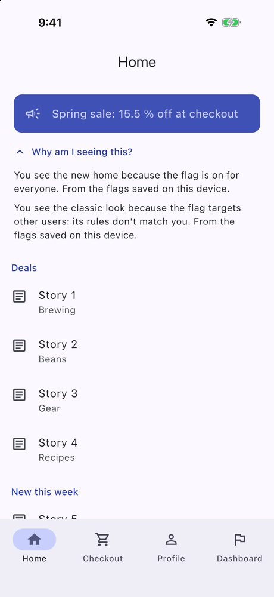 | 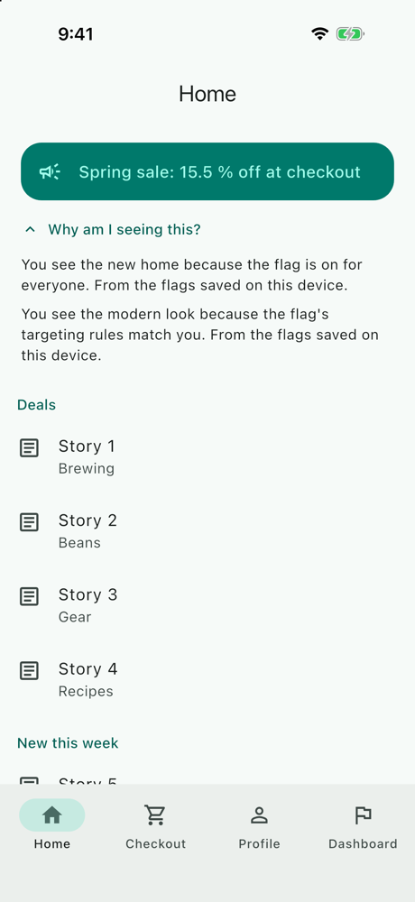 | 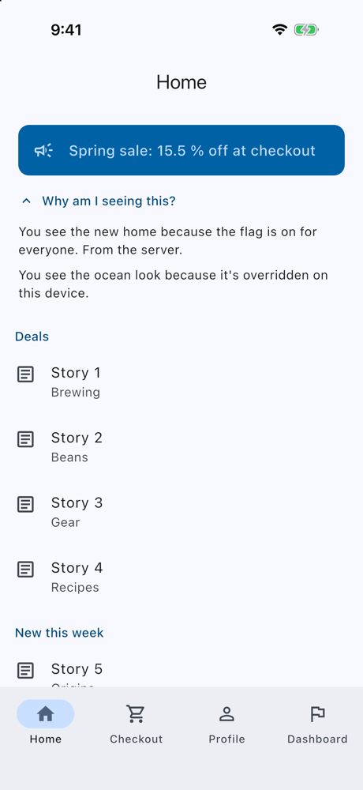 |

## A rollout, targeting and an override

| Checkout (bucket 404, in the 25 %) | Profile | A flag's rules | An override |
|:---:|:---:|:---:|:---:|
| 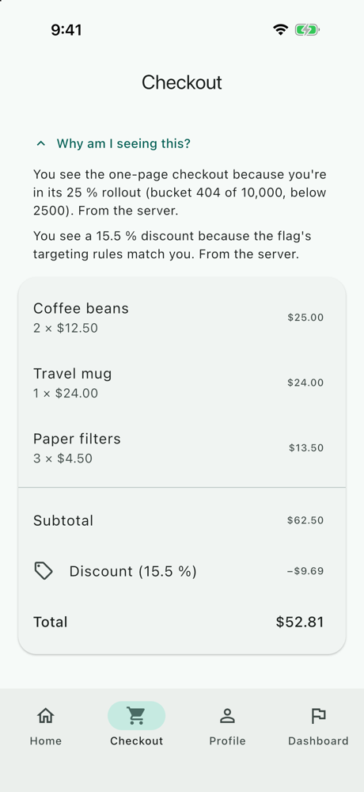 | 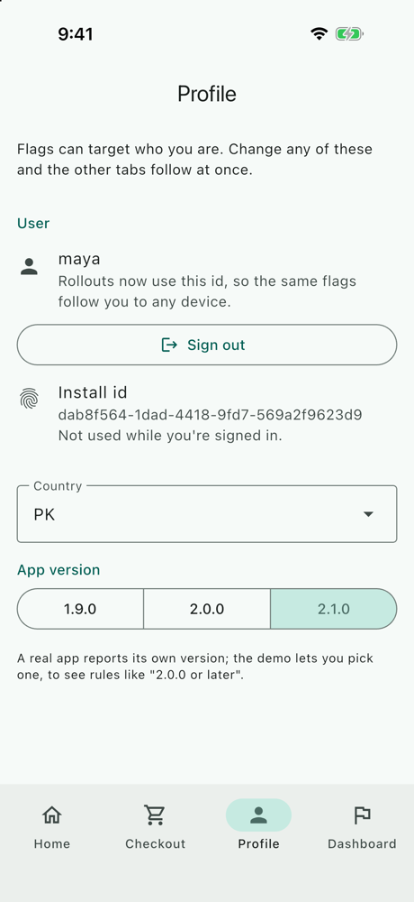 | 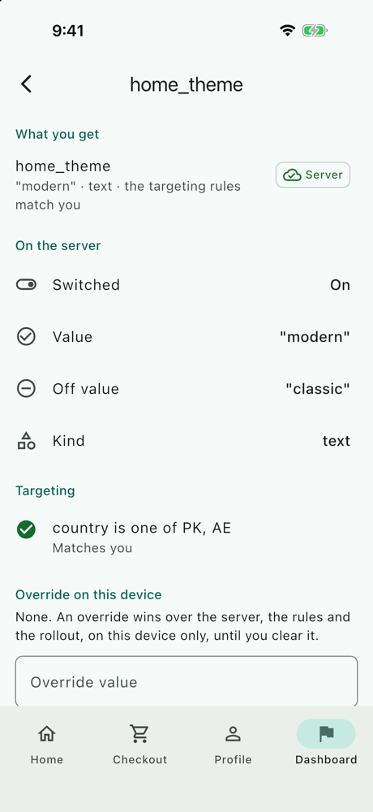 | 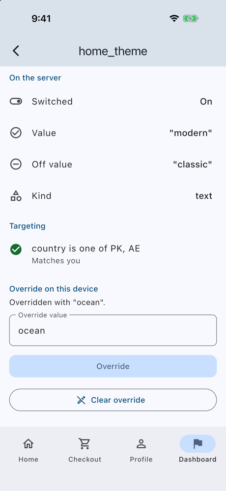 |

## The Dashboard

| The cache and actions | Every flag | With an override |
|:---:|:---:|:---:|
| 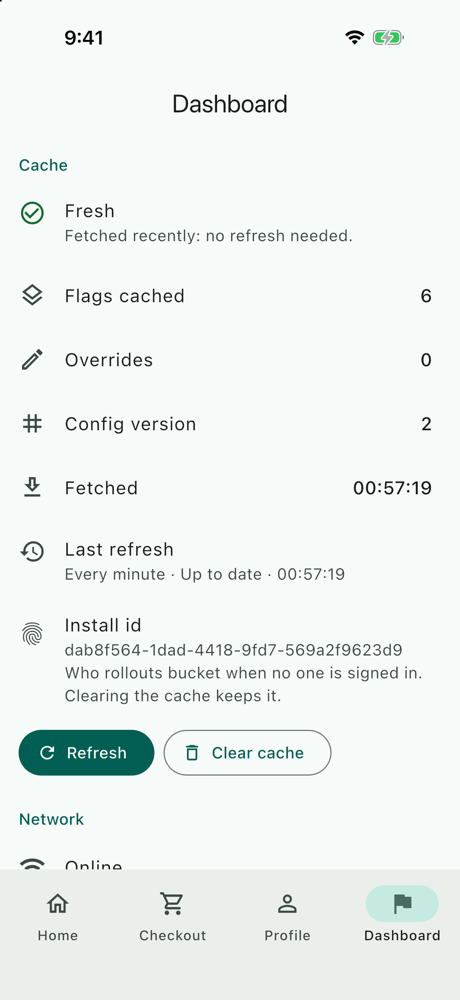 | 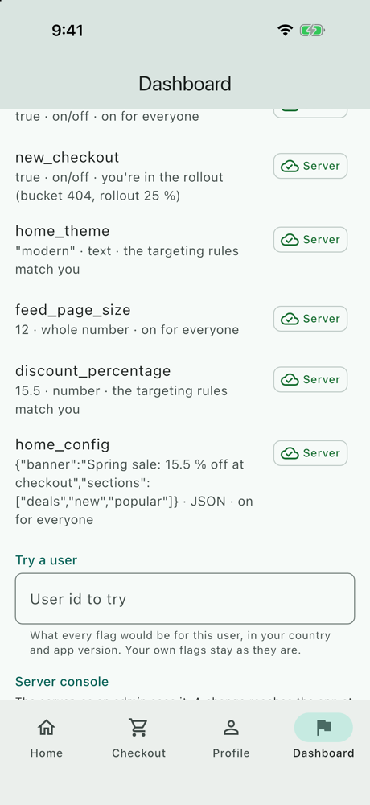 | 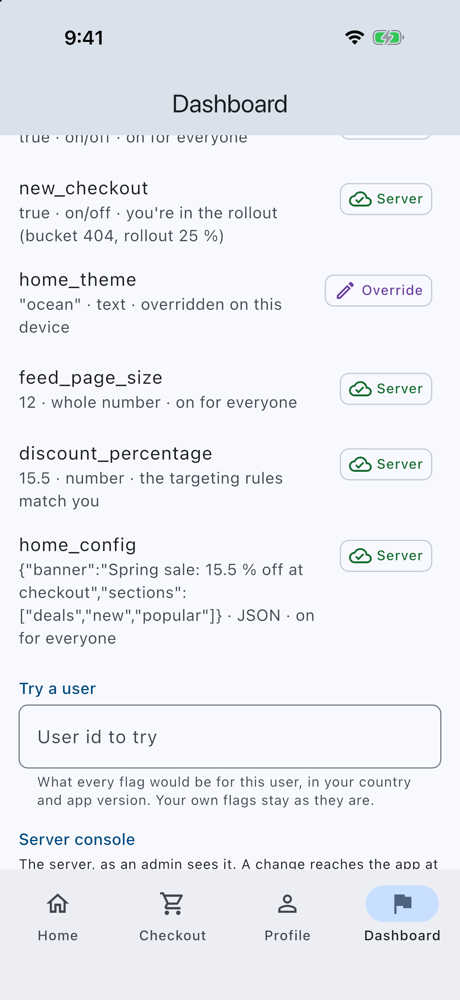 |

## Dark: the demo's controls

| The server console | Device offline | Try a user |
|:---:|:---:|:---:|
| 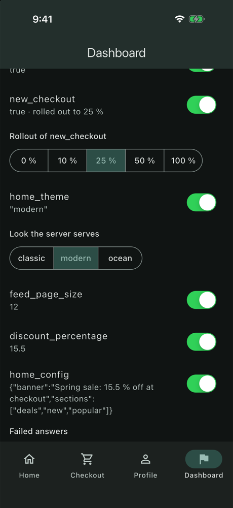 | 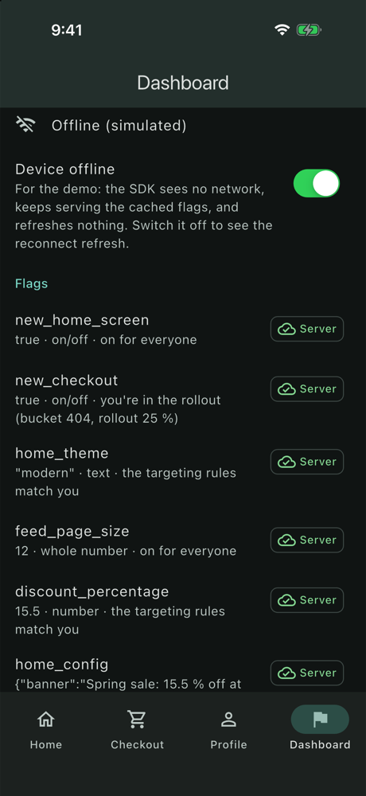 | 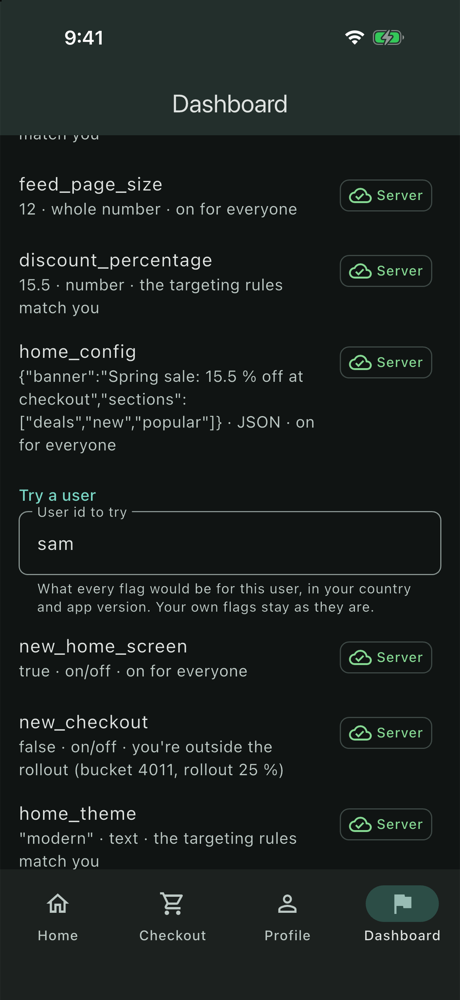 |

## Large text

Accessibility text size **AX3** (about 235 %), light mode. Past 130 %, side-by-side layouts stack: a flag's source chip goes under its details, and a stat's value goes under its label.

| Checkout's why line | The Dashboard |
|:---:|:---:|
| 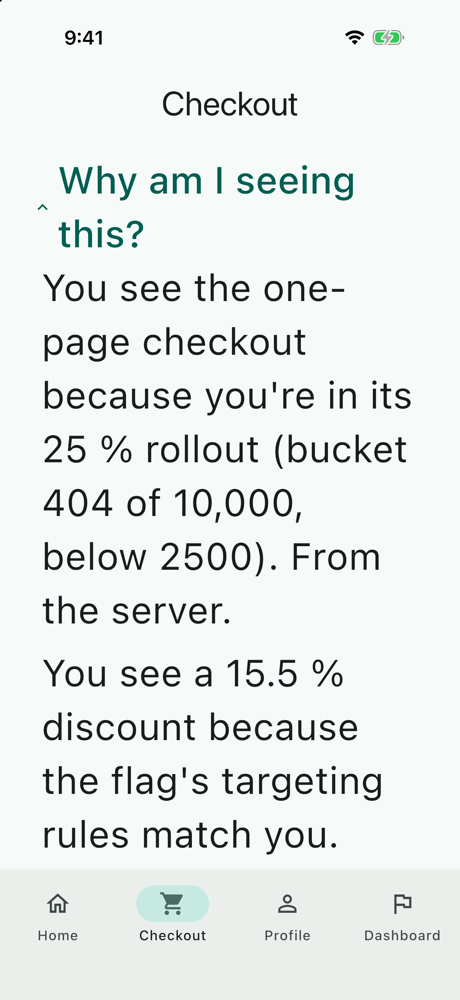 | 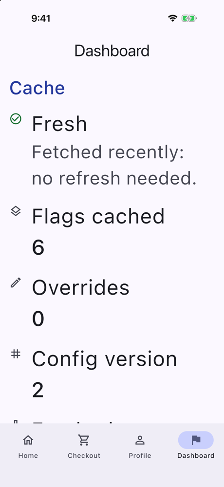 |

The Dashboard's first large-text screenshot found a layout bug: "Fetched" broke mid-word (`Fetche` / `d`) beside a time. A stat's value now goes under its label past 130 %, and a test checks where it is.
